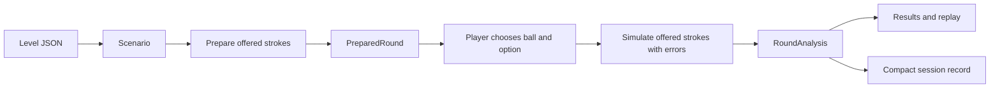

# Architecture

Shot Selection is a browser-based pool training application. A player chooses a ball and a stroke, then compares the choice with simulated alternatives. The same engine powers the course, sandbox, and experimental lab. The application runs entirely in the browser; it has no application backend or remote persistence.

For editing layouts, tuning shot choices, and importing or exporting JSON, use the [level authoring guide](level-authoring.md). The [README](../README.md) covers setup and the player-facing features.

## Stack and repository map

The application uses React and TypeScript, built with Vite. Three.js with React Three Fiber renders the table; Cannon-es supplies ball collisions. Styling combines [global CSS](../src/index.css), component CSS, Tailwind, and small Radix-based [UI primitives](../src/components/ui).

| Location | Responsibility |
| --- | --- |
| [`src/main.tsx`](../src/main.tsx) | Mounts React and the application stylesheet. |
| [`src/App.tsx`](../src/App.tsx) | Coordinates session, course/sandbox modes, round preparation, player selection, analysis, and playback. |
| [`src/levels/`](../src/levels) | Individual level JSON files, their ordered index, and the shared JSON Schema. |
| [`src/engine/`](../src/engine) | Configuration loading, geometry, preparation, simulation, objectives, scoring, lab analysis, and teaching evidence. |
| [`src/components/`](../src/components) | Player flow, table, authoring controls, results, and lesson-specific comparisons. |
| [`src/components/table/`](../src/components/table) | Table furniture, lighting, materials, damage marks, viewport, and placement controls. |
| [`src/lib/`](../src/lib) | Session/highscore persistence, course reports, feedback presentation, and sound/playback utilities. |
| [`e2e/`](../e2e) | Playwright browser tests. Unit tests live beside their source as `*.test.ts`. |

The main shared contracts are in [`engine/types.ts`](../src/engine/types.ts): `Scenario`, `ShotPlan`, `PreparedRound`, `Simulation`, `ShotAnalysis`, and `RoundAnalysis`. The portable `LevelDefinition` wrapper is defined in [`level-config.ts`](../src/engine/level-config.ts); lab stroke settings and variants live in [`lab.ts`](../src/engine/lab.ts).

## A course round from JSON to result



1. [`scenarios.ts`](../src/engine/scenarios.ts) loads and validates the JSON course. `generateScenario(level, seed)` selects a definition and applies its permitted seeded reflections.
2. [`preparation.ts`](../src/engine/preparation.ts) builds a `PreparedRound`. For generated choices it searches candidate strokes, simulates feasibility, establishes any derived landing zone, and checks the lesson's required contrast. Each selectable ball has exactly three `FinishOption`s, labelled A/B/C.
3. [`App.tsx`](../src/App.tsx) presents the prepared scenario and options. Some lessons add planning steps such as shortlisting, nominating the next ball, or choosing its pocket.
4. On commitment, [`analysis.ts`](../src/engine/analysis.ts) evaluates the offered plans with the player's precision settings. It produces nominal replays, trial outcomes, success rates, and diagnostic evidence, then calls [`scoring.ts`](../src/engine/scoring.ts) for decision points.
5. The UI presents the selected and alternative shots. [`session.ts`](../src/lib/session.ts) advances only the next unfinished course lesson and saves compact measured outcomes, preventing a reload from awarding the same lesson twice. Sandbox play does not advance the course.

`PreparedRound.scenario` is the authoritative scenario after preparation: it may contain a generated landing zone or a permitted course variation. UI and analysis should use that scenario, not assume the original requested layout survived preparation unchanged.

Preparation and analysis are separate operations. Generated choices may be filtered by nominal feasibility and lesson evidence, but the engine does not select their A/B/C order by the final player ensemble ranking. Once the player chooses, analysis evaluates the offered plans without introducing stronger unseen alternatives or changing their targets.

## Configuration and derived data

[`levels/index.ts`](../src/levels/index.ts) statically imports the course definitions in order. [`course.ts`](../src/engine/course.ts) defines the chapter structure and total course size; the current course has ten chapters of ten levels. Startup validation requires the full sequence of level numbers and unique document IDs.

Each file contains a `LevelDefinition` with a schema version, identity, level/draft kind, reflection settings, a `scenario`, and optional `lab` settings. The scenario stores layout, briefing text, objectives, table conditions, scoring configuration, generation grids, named tuning values, and optional exact `authoredShots`.

[`level.schema.json`](../src/levels/level.schema.json) is shared by editor hints and runtime shape validation. [`level-config.ts`](../src/engine/level-config.ts) adds semantic checks for ball references, compatible objectives, and physical placement. Its validator implements the schema features used by this repository; adding a new schema keyword may also require extending the validator.

| Function | Boundary |
| --- | --- |
| `parseLevelJson` / `validateLevelDefinition` | Untrusted JSON/object to a checked, cloned authoring document. |
| `scenarioFromLevel` | Authoring document to a runtime scenario, with provenance metadata. Imports preserve exact positions; course generation explicitly requests variation. |
| `levelFromScenario` / `serializeLevelJson` | Runtime state to portable configuration, excluding runtime-only authoring metadata and simulation results. |

The runtime `Scenario.authoring` metadata records origin, whether the layout is imported, and whether an objective target was explicitly supplied. These distinctions prevent an imported layout from silently falling back to a built-in level and let ball editing discard an old generated zone while preserving an explicitly authored one.

JSON configures supported behavior; TypeScript implements that behavior. Physics rules, candidate-search algorithms, objective predicates, teaching-evidence builders, and score formulas remain code. [`lesson-tuning.ts`](../src/engine/lesson-tuning.ts) provides named tunable parameters and compatibility defaults for in-memory scenarios.

Nominal trajectories, ensemble samples, inferred choices, and teaching evidence are derived data. They are recalculated, not persisted in level files. An export can deliberately promote a prepared landing zone or lab strokes into explicit authoring inputs; those inputs must still be simulated again when used.

`authoredShots` selects a separate preparation path: saved strokes are used as written, including deliberate misses. Playing them requires three choices per offered ball and an explicit target for a position objective. Currently, any `curriculum.learning` causes authored preparation to reject the combination: the specialized teaching-evidence path has not been implemented for saved strokes. See the [authoring guide](level-authoring.md) for this distinction and the available workflows.

## Engine execution and simulation

React calls async functions in [`client.ts`](../src/engine/client.ts). Each call creates a dedicated module worker, sends a serializable request, and terminates the worker after completion or error. An `AbortSignal` terminates obsolete work. [`worker.ts`](../src/engine/worker.ts) dispatches preparation, sandbox preparation, course analysis, lab analysis, lab fitting, or tolerance analysis to synchronous engine functions. Tests can call those functions directly without React or a browser worker.

[`physics.ts`](../src/engine/physics.ts) implements `simulateShot(scenario, plan, options)`. It combines Cannon-es sphere collisions with explicit cloth friction, sliding-to-rolling transitions, spin, cushion response, pocket capture, and optional table defects. The simulation uses a fixed 240 Hz step and returns final balls and objective-relevant events; recording options add paths, replay frames, and sound events.

[`constants.ts`](../src/engine/constants.ts) holds shared physical dimensions and baseline parameters. [`table-geometry.ts`](../src/engine/table-geometry.ts) defines pocket openings, cushion noses, and jaws. [`table-conditions.ts`](../src/engine/table-conditions.ts) applies cloth, drift, cushion, cue, and dirty-ball settings. These are shared simulation inputs, not visual-only effects.

The table uses metre coordinates, with the cue ball numbered `0`. Runtime shot angles are radians; lab aim offsets are degrees. Keep unit conversions at the relevant authoring or presentation boundary. This is a teaching simulation with simplified physical effects, not a calibrated professional billiards simulator; its explicit model limits are recorded in `PHYSICS_NOTES`.

### Objectives, ensembles, and points

[`objectives.ts`](../src/engine/objectives.ts) is the central course success evaluator. It checks the legal pot, scratch/settling state, and any position, next-ball, cushion, contact-sequence, or other assignment requirements. It also resolves whether position contributes and which tolerance applies. Table markers and analysis should use these scenario-aware helpers instead of inferring rules solely from a level number.

[`stroke-errors.ts`](../src/engine/stroke-errors.ts) perturbs the requested stroke according to the precision settings in [`characters.ts`](../src/engine/characters.ts). Analysis starts each candidate with the same seeded error sequence, reducing comparison noise and keeping repeated runs reproducible for the same inputs.

[`analysis.ts`](../src/engine/analysis.ts) converts physical trial results to shot utility. [`scoring.ts`](../src/engine/scoring.ts) converts relative utility and rank into 0–100 decision points with tie handling. A result's points, success probability, and nominal replay are distinct values; the replay is one simulation, not a visualization of the success percentage.

[`tolerance.ts`](../src/engine/tolerance.ts) runs a separate sensitivity study around the exact offered stroke, reusing the course objective predicate. Its uniform angle/spin/speed grid is not the player's random-error distribution and does not enter the round score.

### Teaching comparisons

`scenario.curriculum.learning.comparison` selects a supported lesson contrast. The corresponding engine modules derive geometric or simulated evidence; preparation may require that evidence before accepting a layout. Some diagnostics are computed after ensemble analysis instead.

[`LessonComparison.tsx`](../src/components/LessonComparison.tsx) routes most comparison panels, while [`App.tsx`](../src/App.tsx) owns planning interactions. Individual modules such as [`plant-margin.ts`](../src/engine/plant-margin.ts) and their matching comparison components keep subject-specific calculations and presentation separate.

A comparison identifier is an implemented contract, not arbitrary descriptive text. Adding one usually requires the type and schema enum, preparation or analysis evidence, a UI panel, and focused tests proving the intended contrast from actual simulation data.

## Sandbox and lab

[`SandboxSetup.tsx`](../src/components/SandboxSetup.tsx) coordinates scenario mode, lab mode, and their in-memory drafts. [`sandbox.ts`](../src/engine/sandbox.ts) validates placement and searches playable layouts. Manual preparation uses the exact edited layout; it reports failure if the required choices cannot be found. Random preparation varies the supplied scenario while retaining its objectives and settings.

[`LabMode.tsx`](../src/components/LabMode.tsx) manages editable strokes, variations, player precision, lock settings, fitting, and results. [`lab.ts`](../src/engine/lab.ts) evaluates explicit strokes without the course's feasibility filtering; [`lab-auto.ts`](../src/engine/lab-auto.ts) supplies optional automatic fitting. Saved combination strokes retain distinct first-contact and pot-ball IDs; indirect combinations are not automatically fitted.

Lab success means the nominated ball enters the nominated pocket after the correct first contact, without a scratch, with the balls settled. **Lab statistics do not evaluate the complete course position or trick assignment**, even when the imported document preserves that metadata. Use the scenario play flow to verify the full lesson objective.

[`LevelJsonTools.tsx`](../src/components/LevelJsonTools.tsx) provides file import, editable JSON, and downloads. Export is the durable authoring save mechanism: it does not overwrite a repository file. Drafts allow unfinished placement and incomplete sets of strokes; successful JSON validation alone does not establish a playable lesson.

## Rendering and persistence

[`PoolTable.tsx`](../src/components/PoolTable.tsx) renders a Three.js scene when WebGL is available and an interactive SVG table otherwise. Both display the same scenario, offered plans, and simulation results. Replay follows recorded frames rather than running a second physics simulation in the renderer. Keep damage marks, targets, placement, selection, and replay behavior consistent in both views.

[`sound.ts`](../src/lib/sound.ts) supplies game audio, with simulation sound events synchronized to playback through [`playback-events.ts`](../src/lib/playback-events.ts). Visibility and cancellation handling stop obsolete playback.

Browser `localStorage` holds the session, local highscores, and small preferences such as sound/help state. [`session.ts`](../src/lib/session.ts) validates saved data and handles course/scoring migrations; [`highscores.ts`](../src/lib/highscores.ts) merges compact playthrough records, including changes from other tabs. Large simulations and sandbox/lab drafts are not stored there. Storage failure is handled without preventing play.

## Where to make changes and how to verify them

| Change | Start here | Relevant verification |
| --- | --- | --- |
| Level layout, copy, objective, or candidate controls | Level JSON and [authoring guide](level-authoring.md) | Config validation, affected lesson tests, course scenario tests. |
| New authoring field | Types, JSON Schema, `level-config.ts`, then its runtime consumer | Reject malformed values; preserve the field through import/export and reflection. |
| Choice generation or teaching comparison | `preparation.ts`, relevant evidence module, comparison UI | Feasibility and evidence tests; browser flow for the affected lesson. |
| Physics or objective semantics | `physics.ts`, geometry/conditions, `objectives.ts` | Physics/objective tests and broader course regression coverage. |
| Authoring controls or mode transfer | `SandboxSetup.tsx`, `LabMode.tsx`, `LevelJsonTools.tsx` | Authoring, lab, and sandbox browser tests. |
| Table presentation | `PoolTable.tsx`, `components/table/` | WebGL and SVG behavior, including narrow screens and replay. |
| Progress or saved formats | `session.ts`, `highscores.ts`, `App.tsx` | Migration, reload, duplicate-award, and storage-failure tests. |

The commands are defined in [`package.json`](../package.json):

```sh
npm run dev
npm run typecheck
npm test -- src/engine/level-config.test.ts
npm test -- src/engine/scenarios.test.ts
npm run test:e2e -- e2e/level-authoring.spec.ts
npm run build
```

Use `npm test` for the complete Vitest suite and `npm run test:e2e` for all browser tests. Physics-heavy suites can take several minutes. The course scenario tests exercise every level across multiple seeds; specialized tests assert the intended lesson evidence rather than only successful preparation.

[`playwright.config.ts`](../playwright.config.ts) starts or reuses the Vite server on port 5178 by default and runs one browser worker. `PLAYWRIGHT_PORT` and `PLAYWRIGHT_CHROMIUM_EXECUTABLE_PATH` support local overrides. [`vite.config.ts`](../vite.config.ts) defines the `@` source alias and separates the Three.js bundle. Choose checks that cover the behavior changed; documentation-only edits do not require rebuilding the application.
